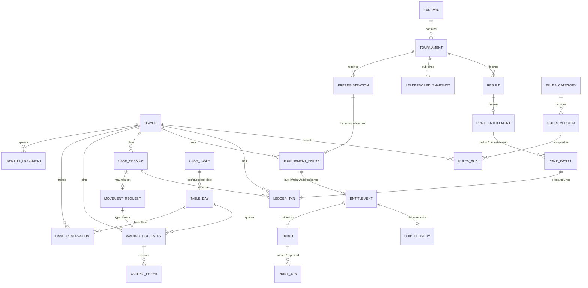
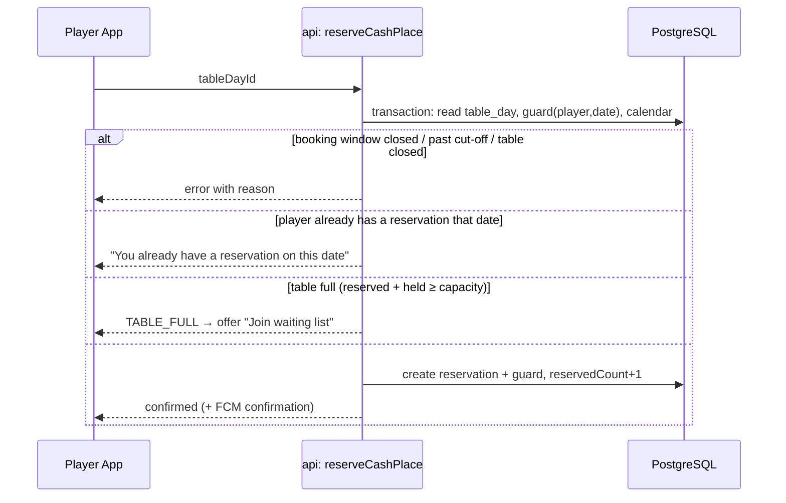
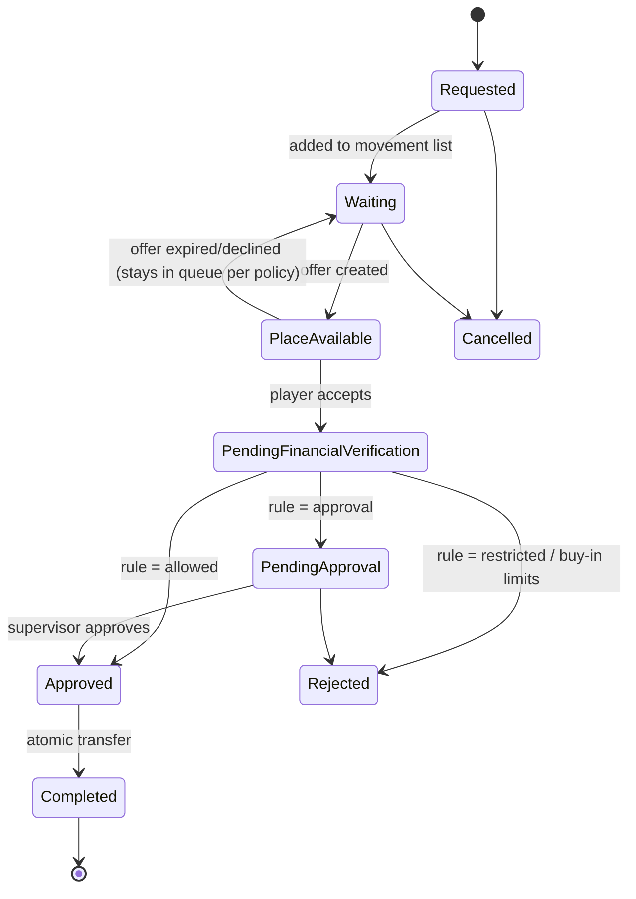
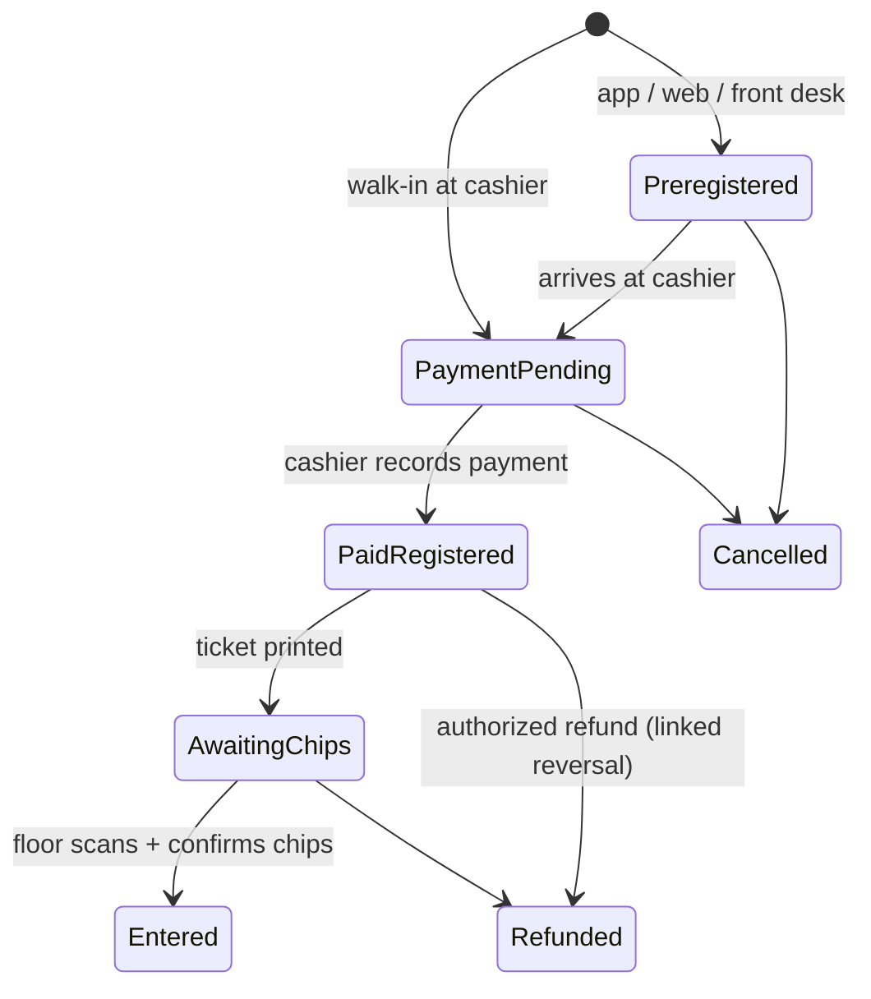

# TiVBook — Architecture, Data Model, Workflows & Milestones

**Platform:** TiVBook by Ti Vegas (Funworld Co Ltd), Grand Baie, Mauritius
**Document version:** Phase 2 (Supabase) — 13 November 2026
**Time zone:** Indian/Mauritius (UTC+04:00, no daylight saving)
**Currency:** Mauritian Rupee (MUR / Rs). All money stored as integer cents.

---

## 0. What gets installed

| Deliverable | Contains | Install |
|---|---|---|
| **TiVBook Staff** | Admin, Cashier, Floor, Front Desk, scanning, first-time setup wizard | **One Windows setup** (`TiVBook-Staff-Setup.exe`, one click, no admin rights) |
| **TiVBook** player app | Registration, bookings, tournaments, alerts | Separate download for Android (`TiVBook-Player.apk`); iPhone via App Store later |

Both connect to the casino's own **free Supabase** project and sync live. See `docs/SETUP.md`.

## 1. Architecture overview

```mermaid
flowchart TB
  subgraph Clients
    PA[TiVBook player app<br/>React + Capacitor · Android/iOS]
    ADM[TiVBook Staff<br/>Admin · Cashier · Floor · Front Desk · Scanner<br/>React in Electron · one Windows setup]
  end

  subgraph Supabase["Supabase (free plan) — the casino's own project"]
    AUTH[Auth<br/>staff e-mail logins · player logins after WhatsApp OTP<br/>role in app_metadata]
    FN[Edge Function "api"<br/>all writes · roles · device approval · rules engine]
    DB[(PostgreSQL<br/>tables · constraints · Row Level Security)]
    RT[Realtime<br/>live updates to every screen]
    ST[(Storage<br/>private ID-photo bucket)]
    CRON[pg_cron every minute<br/>cut-offs · offer expiry · next alarm]
  end

  subgraph External
    WA[WhatsApp Cloud API<br/>authentication template]
    FCM[Firebase Cloud Messaging<br/>free push alarms]
  end

  PA & ADM --> AUTH
  PA & ADM -->|POST /functions/v1/api| FN
  PA & ADM -->|read, filtered by RLS| DB
  RT --> PA & ADM
  FN --> DB & ST & AUTH
  FN --> WA & FCM
  CRON --> FN
  CORE[[packages/core<br/>shared business rules<br/>TypeScript, tested]] -.bundled into.-> FN
  CORE -.used by.-> ADM
```

### Key design decisions

| Decision | Reason |
|---|---|
| **Supabase free plan** (PostgreSQL) instead of Firebase | No bank card needed; all needed services included free. |
| **Every write goes through the `api` server function.** Apps only *read*, and Row Level Security decides what each role can see. | Server-side checks of roles, approved devices and business rules. |
| **The database itself enforces the critical rules**: one reservation per player per date (unique index), no overbooking (`active + held ≤ capacity` check), chips once per paid item (primary key), append-only ledger (trigger). | Even a bug or two simultaneous clicks cannot break them. Proven by concurrency tests (20 players at once, double-click payments, two scanners on one ticket). |
| **Row locks in a fixed order** (table-day first) | No deadlocks under load. |
| **One shared rules package (`packages/core`)** | Same rules in the server and the staff screens. |
| **Money as integer cents; append-only ledger with linked reversals** | Exact sums; full audit trail. |
| **Server time for deadlines**; **idempotency keys**; **HMAC-signed ticket codes** | Unchanged from Phase 1. |
| **One-click setup wizard inside TiVBook Staff** (Supabase Management API, token used once, never saved) | No terminal, no programming tools. |
| **Electron** for the Windows app | Can be built and tested here; one self-contained installer; the page has no access to the PC except two narrow functions (setup network calls to Supabase only, opening approved links). |
| **Connection code / QR** (`TVB1-…`) | Other PCs and phones connect once without typing technical settings. Contains only the public key. |

### Costs

| Service | Cost |
|---|---|
| Supabase free plan (database, logins, storage, server function, live sync, timer) | Free, no card |
| Firebase Cloud Messaging (optional phone alarms) | Free |
| WhatsApp authentication messages | Small per-message fee from Meta |
| Apple Developer Program (iPhone app) | USD 99/year — optional, later |
| Google Play Console (Play Store) | USD 25 once — optional; the APK can be shared directly |
| Windows code-signing certificate | Optional (removes the "unknown publisher" warning) |

---

## 2. Monorepo layout

```
tivbook/
├── packages/core/        Business rules (TypeScript, no I/O) — 59 tests
├── packages/client/      Shared app pieces: connection, server calls, live data, EN/FR, registration, ID photos
├── server/
│   ├── sql/schema.sql    Database: tables, constraints, RLS, realtime, storage bucket
│   ├── src/              The "api" server function (handlers, router, Deno entry)
│   └── test/             Integration tests against a real PostgreSQL — 18 tests
├── apps/
│   ├── staff/            TiVBook Staff (React) + desktop/ (Electron) + setup/ (one-click wizard)
│   └── player/           TiVBook player app (React) → Android/iOS via Capacitor
├── .github/workflows/    Automatic Android (and Windows) builds
└── docs/                 Architecture, setup
```

Admin, Cashier, Floor, Front Desk and scanning are **one staff application with role-based sections**, installed with **one setup file**. The login decides which sections appear; every staff PC must be approved once (Devices). The player app is the only separate download.

---

## 3. Roles and permissions

| Permission | Super Admin | Manager | Tournament Director | Cashier | Floor Supervisor | Dealer | Front Desk | Player |
|---|---|---|---|---|---|---|---|---|
| Register players / upload ID | ✓ | ✓ | | ✓ | | | ✓ | self |
| View identity documents | ✓ | ✓ | | ✓ | | | ✓ (upload only) | own |
| Create / cancel cash reservations | ✓ | ✓ | | ✓ | ✓ | | ✓ | own |
| Manage tables & calendar | ✓ | ✓ | | | | | | |
| Seat players / waiting-list control | ✓ | ✓ | | | ✓ | | | |
| Approve table movement exceptions | ✓ | ✓ | | | ✓ **(auth)** | | | |
| Create festivals / tournaments | ✓ | ✓ | ✓ | | | | | |
| Confirm payments, print tickets | ✓ | ✓ | | ✓ | | | | |
| Ticket reprint | ✓ **(auth)** | ✓ **(auth)** | | request | | | | |
| Scan tickets / confirm chips | ✓ | ✓ | ✓ | | ✓ | ✓ | | |
| Leaderboards | ✓ | ✓ | ✓ | | ✓ | | | |
| Approve results | ✓ | ✓ | ✓ | | | | | |
| Prize payouts | ✓ | ✓ **(auth)** | | ✓ **(auth)** | | | | |
| Tax override / financial adjustment / reversal | ✓ **(auth)** | ✓ **(auth)** | | | | | | |
| Publish rules | ✓ **(auth)** | ✓ **(auth)** | ✓ (tournament rules) | | | | | |
| User accounts, audit logs, settings | ✓ | view | | | | | | |

**(auth)** = second-person authorization: a supervisor enters their own PIN on the requesting device. Both identities are written to the audit log.

Roles are stored in each login's server-only `app_metadata` (`role`, `player_id`) and re-checked inside the server function on every call, together with the approved-device check.

---

## 4. Data model

### 4.1 Entity relationships



### 4.2 Tables

> Since the move to Supabase these are PostgreSQL tables with snake_case columns; **`server/sql/schema.sql` is the exact, authoritative definition** (constraints, indexes, RLS). The list below describes their purpose. Monetary fields end in `cents` and are integers.

| Collection | Key fields | Notes |
|---|---|---|
| `counters/playerId` | `next` | Incremented in a transaction → permanent sequential IDs `001, 002 … 999, 1000 …`. Never reused. |
| `players/{playerId}` | `surname*`, `firstNames`, `phoneE164*`, `phoneVerifiedAt`, `address`, `countryOfResidence`, `nationality`, `idDocType`, `idDocNumberHash*`, `dateOfBirth`, `status` (pending / active / suspended), `kycStatus` (unverified / verified / rejected), `searchTokens*`, `createdAt`, `createdBy` | Doc ID **is** the player ID. ID number stored hashed for search; full value only in the restricted sub-document `players/{id}/private/identity`. |
| `players/{id}/private/identity` | `idDocNumber`, `verifiedBy`, `verifiedAt` | Readable only by Cashier/Front Desk/Manager+. |
| `identity_documents/{docId}` | `playerId*`, `kind` (id_front, id_back, passport), `storagePath`, `contentType`, `uploadedBy`, `replacedBy` | Files in a private Storage bucket; staff view through short-lived signed URLs. |
| `otp_challenges/{id}` | `phoneE164`, `codeHash`, `expiresAt`, `attempts`, `sends`, `ip` | Server-only. 5-minute expiry, 5 attempts, 3 resends / hour, rate-limited per phone and per IP. |
| `cash_tables/{tableId}` | `name`, `gameType`, `smallBlindCents`, `bigBlindCents`, `minBuyInCents`, `maxBuyInCents`, `defaultCapacity`, `active` | Master configuration. |
| `table_days/{tableId_YYYY-MM-DD}` | `tableId*`, `date*`, `capacity`, `opensAt`, `cutoffAt`, `status` (open / closed), `reservedCount`, `checkedInCount`, `seatedCount`, `heldCount`, `waitingCount`, `seats[1..9]` → `playerId?` | **The atomic counter document.** Every reservation, offer and seating change locks this one doc in a transaction, so overbooking is impossible. |
| `cash_reservations/{id}` | `playerId*`, `date*`, `tableDayId*`, `status` (reserved / checked_in / seated / cancelled / expired / no_show), `source` (app / web / front_desk / cashier / admin), timestamps | Unique constraint *one per player per date* enforced with a guard doc `reservation_guards/{playerId_date}` created in the same transaction. |
| `booking_calendar/settings` | `openWeekday` (0=Sun), `openTime` ("10:00"), `windowDays` (7), `exceptions[]`, `closedDates[]` | Weekly opening policy. |
| `waiting_lists/{id}` | `tableDayId*`, `listType` (new_player / movement), `playerId*`, `currentTableDayId?`, `movementRequestId?`, `requestedAt`, `status` (waiting / offered / accepted / declined / expired / skipped / cancelled / fulfilled), `priorityOverride?` | Queue position is calculated live from the table's priority policy, not stored, so it can never go stale. |
| `waiting_offers/{id}` | `waitingEntryId*`, `tableDayId*`, `playerId*`, `createdAt`, `expiresAt*`, `status` (pending / accepted / declined / expired / cancelled), `notifications[]`, `respondedAt` | One pending offer holds one place (`heldCount`) until it is accepted or expires. |
| `cash_sessions/{id}` | `playerId*`, `tableDayId*`, `seat`, `openedAt`, `closedAt`, `status` (open / closed / transferred), `initialBuyInCents`, `additionalBuyInsCents`, `transferInCents`, `currentChipValueCents`, `closingValueCents` | A movement closes one session and opens another, linked by `movementId`. |
| `table_movement_rules/current` | matrix `{winning|losing|break_even} × {higher|equal|lower} → allowed / approval / restricted` | Default matrix in §6. |
| `table_movement_requests/{id}` | `playerId*`, `fromSessionId`, `toTableDayId`, `status` (requested → … → completed), `verifiedChipValueCents`, `classification`, `direction`, `decision`, `approvedBy?`, `history[]` | |
| `festivals/{id}` | `name`, `logoPath`, `description`, `startDate`, `endDate`, `images[]`, `announcements[]` | |
| `tournaments/{id}` | `festivalId*`, `name`, `startAt*`, `buyInCents`, `feeCents`, `startingChips`, `format` (freezeout, reentry, rebuy, bounty, mystery_bounty, satellite, turbo, hyper_turbo, multi_day), `reentry {allowed, max, untilLevel}`, `rebuy {priceCents, chips, max, untilLevel}`, `addon {priceCents, chips, atBreak}`, `bonus {priceCents, chips}`, `levels[]`, `lateRegCloseAt`, `maxEntries`, `prizeStructureId`, `rulesVersionId`, `status`, `counters{…}` | `counters` updated in the same transaction as each payment/scan, so every dashboard shows the same numbers. |
| `tournament_preregistrations/{id}` | `tournamentId*`, `playerId*`, `options{bonus}`, `reference`, `status` (preregistered / cancelled / converted), `source` | No ticket until paid. |
| `tournament_entries/{id}` | `tournamentId*`, `playerId*`, `entryNumber` (1 = first, 2+ = re-entries), `status` (payment_pending / paid / awaiting_chips / entered / cancelled / refunded), `preregistrationId?` | |
| `entitlements/{id}` | `entryId*`, `kind` (buy_in / reentry / rebuy / addon / bonus), `priceCents`, `chips`, `paymentTxnId`, `ticketId`, `chipDeliveryId?` | Each paid item = one chip entitlement = one scannable ticket. |
| `tickets/{id}` | `entitlementId`, `tokenHash*`, `status` (valid / used / void), `printedCount`, `template` | The token itself is never stored, only its hash. |
| `ticket_print_jobs/{id}` | `ticketId`, `copyPurpose` (player_floor / dealer / cashier), `isReprint`, `reason?`, `authorizedBy?`, `operator`, `printer`, `result` | |
| `chip_deliveries/{entitlementId}` | `scannedBy`, `deviceId`, `scannedAt`, `chips` | **Doc ID = entitlement ID.** Creating it twice fails → duplicate chip delivery is physically impossible. |
| `leaderboards/{tournamentId}/snapshots/{id}` | `rows[{playerId, chips, rank}]`, `status` (draft / published), `publishedBy`, `takenAt` | |
| `tournament_results/{tournamentId}` | `entriesCount`, `prizePoolCents`, `rows[{position, playerId, grossCents}]`, `status` (draft / approved / published), `approvedBy`, `revisions[]` | |
| `prize_entitlements/{id}` | `tournamentId`, `playerId*`, `position`, `grossCents`, `taxCents`, `netCents`, `paidNetCents`, `status` (pending / partially_paid / paid) | |
| `prize_payouts/{id}` | `prizeEntitlementId*`, `instalment`, `netCents`, `method`, `cashierId`, `receiptNo`, `paidAt` | One receipt per instalment (daily cash cap). |
| `tax_rules/{id}` | `category`, `rateBp` (basis points), `thresholdCents`, `method` (whole_amount / excess_only), `effectiveFrom`, `effectiveTo?` | Not hard-coded. |
| `payout_limits/current` | `dailyCashCapCents` | Configurable. |
| `ledger/{txnId}` | `playerId*`, `type*`, `amountCents`, `direction` (in / out / non_cash), `currency`, `ref {tableDayId? tournamentId? sessionId? entitlementId?}`, `cashierId*`, `stationId`, `shiftId*`, `method`, `authRef?`, `reversesTxnId?`, `reversedByTxnId?`, `status`, `notes`, `idempotencyKey*`, `createdAt*` | Append-only. A database trigger forbids update/delete. |
| `cashier_shifts/{id}` | `cashierId`, `stationId`, `openedAt`, `openingFloatCents`, `closedAt`, `declaredCents`, `expectedCents`, `varianceCents`, `status` | Expected cash is calculated from the ledger. |
| `rules_categories/{id}`, `rules_versions/{id}`, `rules_acks/{playerId_versionId}` | category, language, `body` (structured blocks), `effectiveFrom`, `publishAt`, `status`, `versionNo` | Acknowledgement stores the exact version and timestamp. |
| `notification_schedules/{id}`, `notification_history/{id}` | title, body, audience query, `sendAt`, `rrule`, delivery results | |
| `alert_settings/{playerId}` | per-alert sound / vibration / repeat preferences | |
| `audit_logs/{id}` | `actor`, `authorizer?`, `action`, `entity`, `before`, `after`, `at`, `deviceId`, `ip` | Written by functions only; nobody can edit. |
| `idempotency/{key}` | `result`, `createdAt` | Lets a retried request return the original result. |
| `system_settings/*` | offer duration, waiting-list policy, reminder offsets, ticket copy count … | |

---

## 5. Cash-game workflows

### 5.1 Reservation



- **Booking window:** by default, reservations open each **Sunday** (configurable time) for the following **Monday–Sunday**. Admin can change the weekday, time, window length, exceptional and closed dates.
- **Cut-off:** a scheduled job runs every minute. Reservations not checked in by the table's `cutoffAt` become `expired`. Each released place triggers the waiting-list engine. Checked-in reservations are never expired by this job.

### 5.2 Waiting list and Place Available alarm

1. A place is released (cancellation, expiry, player leaves, table change, admin release, capacity increase).
2. `onPlaceReleased(tableDayId)` runs in a transaction. It chooses the next eligible player using the table's priority policy (FIFO / existing-player first / new-player first / alternating / manual), creates a `waiting_offer` with `expiresAt = now + offerDuration` (default **5 min**), and adds 1 to `heldCount`.
3. FCM high-priority message with the **TiVBook alarm sound**, sent on Android notification channel `place_available` (importance HIGH, custom sound, vibration) and as an iOS time-sensitive alert with a custom sound. The app shows a full-screen alert with a countdown taken from the server's `expiresAt`, and **Accept / Decline** buttons.
4. **Accept** → transaction checks the offer is still `pending` and `expiresAt > serverNow`. A new player gets a reservation. A movement applicant's request goes to *Pending Financial Verification*, and the original seat is **not** released yet.
5. **Expiry / decline** → offer closed, hold released, next player offered, floor dashboard notified.
6. Staff controls: Notify, Resend, Extend Deadline, Cancel Offer, Skip (reason required), Manually Confirm (authorization required). Each one is audit-logged.

Honest limitation, shown in the app's settings: iOS and Android can block sounds in silent/Do-Not-Disturb mode or when the user has turned off notifications. TiVBook asks for permission, explains why, and shows a warning banner when alerts are blocked. It does not promise the phone will always ring.

### 5.3 Table movement



**Calculation (in `packages/core/movement.ts`):**

- Total Buy-In = Initial + Additional buy-ins (+ value transferred in from an earlier movement)
- Profit/Loss = Current Chip Value − Total Buy-In → Winning / Losing / Break-Even
- Direction is decided by comparing the destination minimum buy-in with the current table's minimum buy-in → Higher / Equal / Lower.

**Default matrix** (editable by admin):

| Status | Higher | Equal | Lower |
|---|---|---|---|
| Winning | Allowed | Allowed | **Restricted** |
| Losing | Allowed | Allowed | Approval required |
| Break-Even | Allowed | Allowed | Approval required |

**Transfer rules enforced by the server:**

- Value out = value in (full-value transfer). Partial cash-out to move is refused.
- If chip value is **below the destination minimum**, the move is refused. The player may add a buy-in at the destination only if casino rules allow it (configurable).
- If chip value is **above the destination maximum**, the move is refused. Chips are never removed automatically. (The "Lower + Winning" case is usually caught here too.)
- Completing the move is **one transaction**: close the source session and its seat, open the destination session and seat, write `transfer_out` and `transfer_in` ledger lines (non-cash, they do not count as money received), update both `table_days`, fulfil the waiting entry.

---

## 6. Tournament workflows

### 6.1 Registration lifecycle



### 6.2 Cashier: payment and ticket

1. Search by ID / name / phone / ID reference → open player card (profile, KYC status, reservations, preregistrations, spending summary).
2. Verify identity (blocked if KYC is not verified or the player is under the minimum age).
3. Select tournament and options. **Total payable is calculated by `core/tournament.ts`**: buy-in + optional bonus, with the starting chips + bonus chips shown.
4. Record payment → one transaction: ledger lines, entry `paid`, entitlement(s), ticket(s) with signed token, tournament counters updated, idempotency key stored.
5. Print 3 copies (Player/Floor, Dealer, Cashier) on the Epson TM-T88V. A printer error does **not** undo the payment. The ticket stays `valid` and can be reprinted with authorization, marked **REPRINT**.

### 6.3 Floor: scanning

`validateTicket(token)` → checks HMAC signature → looks up ticket by hash → shows player, tournament, item, chips. Floor taps **Confirm chips delivered** → transaction **creates** `chip_deliveries/{entitlementId}`. If the doc already exists the screen shows **ALREADY VALIDATED** with the original time and operator. A bad signature, unknown, void or unpaid ticket shows **INVALID OR UNPAID TICKET**. Several scanners can work at once safely, because the document creation is the lock.

### 6.4 Results and payouts

Results draft → Tournament Director approves → published. Approval creates `prize_entitlements` with tax calculated by `core/tax.ts` from the active `tax_rules` row.

**Default configuration (to be confirmed with the MRA / GRA before go-live):** 10 % withheld on the **whole amount** when the gross prize is **Rs 100,001 or more**. Daily cash payout cap **Rs 500,000**. Larger prizes are split into instalments on later days, with **one receipt per instalment** (`core/payout.ts` plans the split). Both values are editable settings with effective dates, not code.

---

## 7. Notification and alarm engine

| Channel | Use |
|---|---|
| FCM data + notification, channel `place_available` (custom sound, HIGH) | Place available, offer expiring |
| FCM channel `reminders` (default sound) | Reservation, tournament, late-reg countdown reminders |
| FCM to staff topics (`floor`, `cashier`, `admin`) | New preregistration, printer error, reprint auth, payout approval, invalid/duplicate scan |
| WhatsApp template (optional, approved templates only) | OTP; optional reservation/tournament reminders |

Reminder offsets (24 h, 3 h, 1 h, 30, 15, 5 min, at deadline, custom) are stored per event type. A scheduler job runs every minute and sends due reminders, with an idempotency key per *(player, event, offset)* so nobody receives the same reminder twice.

Sound assets will be **original TiVBook tones**, not taken from other apps.

---

## 8. Security and privacy

- HTTPS everywhere; Supabase encrypts data at rest.
- Identity documents: private bucket, only the server can read files; staff see photos through the server, every view audit-logged. Document numbers are kept in a separate table visible only to Cashier/Front Desk/Manager+, and searched by hash.
- Staff devices must be approved (Devices page) before any staff action works; disabled accounts are blocked immediately.
- Row Level Security: players read only their own rows; staff read according to role; **no app can write any table directly**.
- WhatsApp and push credentials are stored in a server-only table, entered by the Super Administrator, never readable by any app.
- Session timeout on staff PCs (configurable, default 15 min idle) with PIN re-entry.
- Daily backup export (planned; the Supabase free plan has no automatic backups); documented restore procedure.
- **Compliance check before go-live:** Mauritius Data Protection Act 2017 (registration with the Data Protection Office, privacy notice, retention periods), Gambling Regulatory Authority requirements for player identification and records, and FIAMLA / FIU obligations for customer due diligence and large transactions. WhatsApp OTP proves the phone number only. It never replaces ID/age verification at the cashier.

---

## 9. Implementation milestones

| Phase | Deliverable | "Done" means |
|---|---|---|
| **1** | Architecture, data model, workflows; **`packages/core` rules engine with tests** | ✓ Done |
| **2** | Player registration, ID upload, WhatsApp OTP, sequential IDs, staff accounts, device approval; **Supabase backend; one-click Windows setup with setup wizard** | ✓ Done (first live run = first real test) |
| 3 | Tables, calendar, reservations | Weekly opening, one-per-date, cut-off expiry live |
| 4 | Waiting lists, Place Available alarm, table movements | Alarm rings on a real phone; concurrent-accept test passes |
| 5 | Rules & Policies editor + acknowledgements | Rules published to app/web with versioning |
| 6 | Festivals, programmes, preregistration | Programme visible with countdowns |
| 7 | Cashier operations, shifts, ledger | Payment → ledger → shift reconciliation balances to the cent |
| 8 | Ticket designer + Epson TM-T88V printing | Real ticket printed and scanned |
| 9 | Floor dashboard + mobile scanner | Two phones scanning at once, zero duplicate deliveries |
| 10 | Re-entries, rebuys, add-ons, bonuses | |
| 11 | Leaderboards, results, payouts, tax | Payout receipt with instalments |
| 12 | Reports and exports (PDF/Excel/CSV) | |
| 13 | Notification centre, reminders, sounds | |
| 14 | Security hardening, load test, staff pilot | Pilot on one festival |
| 15 | Store releases, Windows installer, manuals | Signed builds |

**What needs the casino before going live:**
1. A free Supabase account (created during the setup wizard).
2. A WhatsApp Business account with an approved authentication template.
3. Apple Developer and Google Play accounts in the company's name.
4. The Ti Vegas logo in high resolution (SVG or PNG ≥ 1000 px).
5. Confirmation of the tax rule, daily cash cap, minimum age and KYC requirements from compliance.
6. Current cash tables (names, stakes, min/max buy-in) and opening hours.
